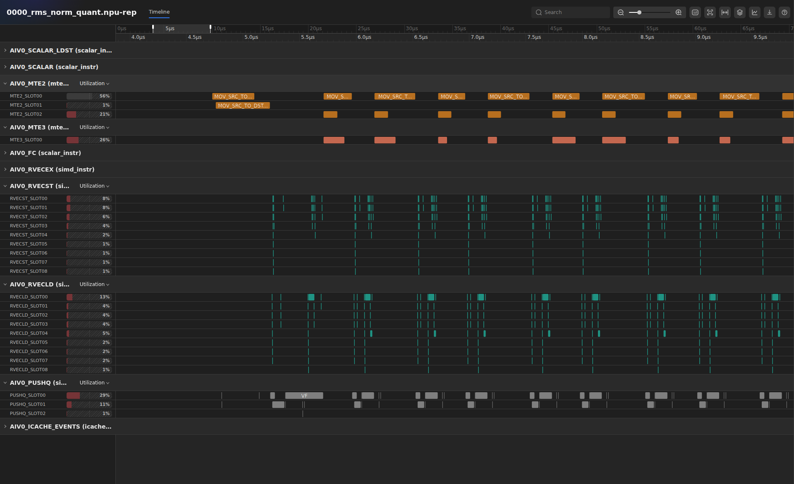
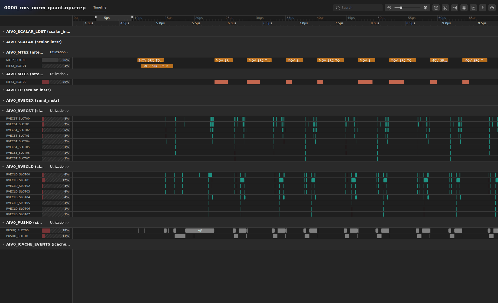
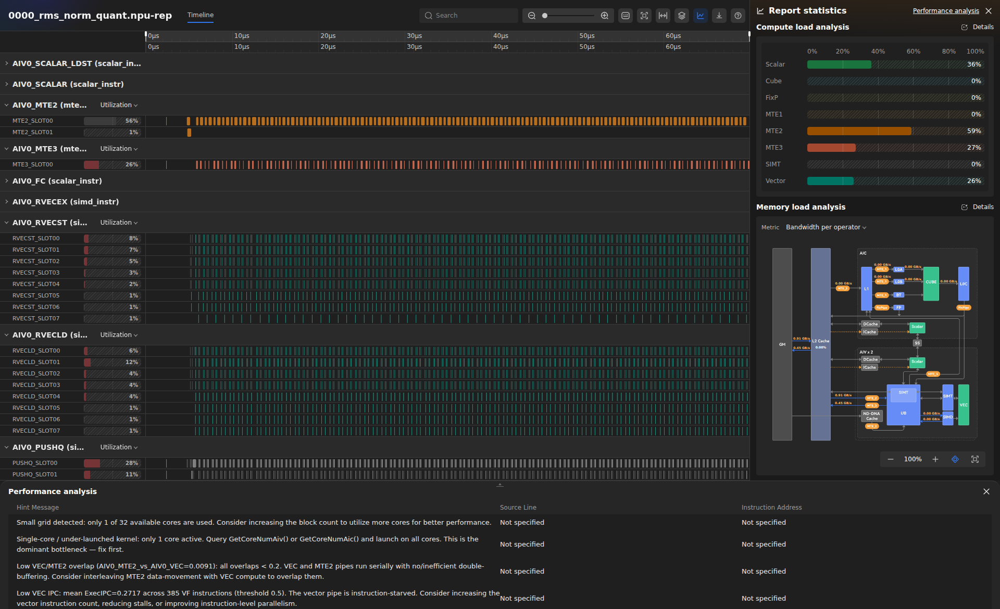
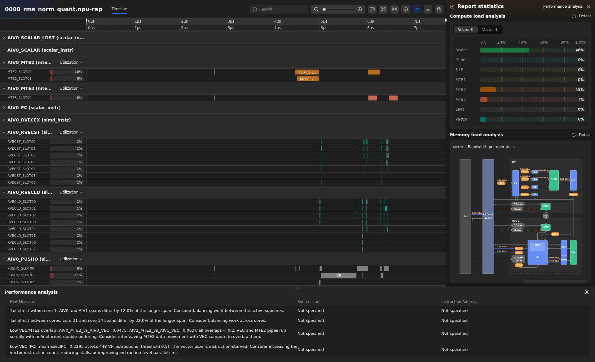
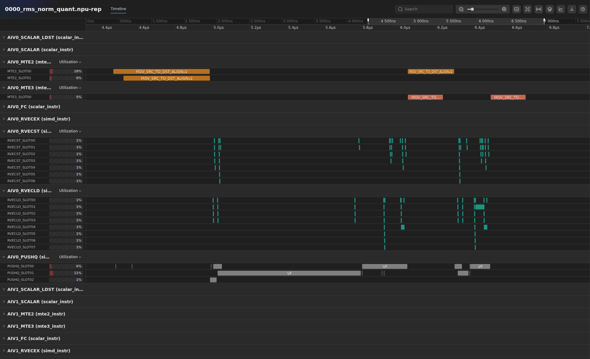
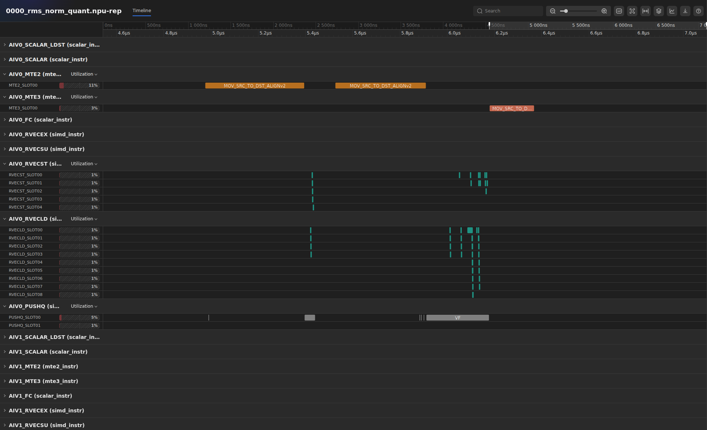
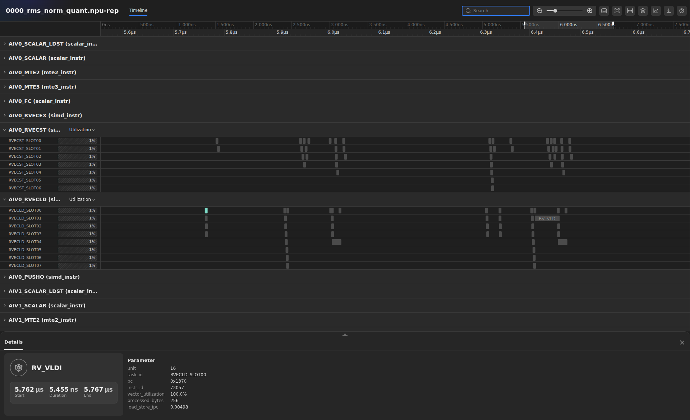
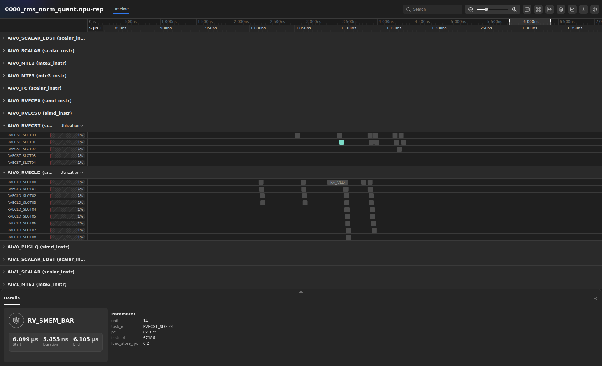
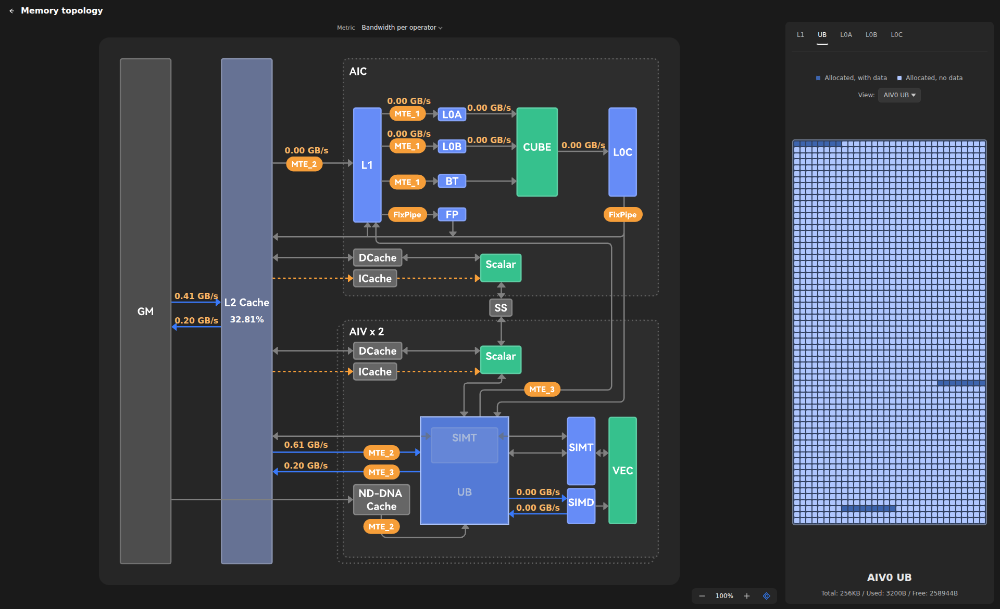
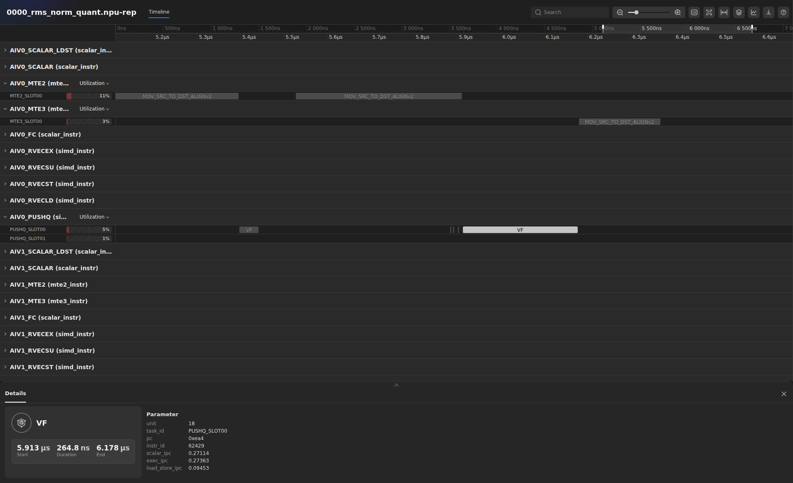

# From a visible problem to a verified improvement

[Русская версия](DEMO_STORY_RU.md) · [Setup and launch reference](README.md)

**Four reports, 7–9 minutes: 0 → 1 → 2 → 5.** Open the saved `.npu-rep` files in the
[web profiling report viewer](https://profiling-report.vercel.app/) or the VS Code profiling extension
before the talk. Each transition follows the same
pattern: find a problem in the report, change the implementation, then check the
next report for the expected change.

The figures are actual English web-viewer captures of the saved reports linked below.
The original PNGs open at full resolution from `figures/demo/`.

We use the same RMSNorm + quantization workload, **128 × 256**, throughout.
All numbers refer to the linked saved runs; a new run can produce different timings.
All four numerical checks pass with the original absolute int8 tolerance of 1.
The times below are simulated kernel clocks, not the host time spent generating a profile.

| Report | Kernel clocks | What this stop demonstrates |
| --- | ---: | --- |
| 0 — naive | 112,429 | Repeated input transfers inside the row loop |
| 1 — preload gamma | 111,498 | Redundant gamma transfers removed; single-core hint remains |
| 2 — multi-core | 8,785 | Work distributed; Small Grid / Single-core hints disappear |
| 5 — batch rows in UB | 7,744 | Fewer VF dispatches and transfers per subcore |

## Navigation in the web viewer

Open [the web viewer](https://profiling-report.vercel.app/), choose **en** in the
top bar for the English labels used below, and use **Open file…** to load the
saved `.npu-rep`.

The **Timeline** occupies the main area. Expand or collapse lane groups with the
arrow beside their names. Collapse the many SCALAR slot rows when they hide the
MTE2, MTE3, PUSHQ, RVECLD, or RVECST groups needed for a comparison. Selecting an
instruction opens its event details; this is where to inspect its parameters.
In these multicore imports the AIV0/AIV1 group names repeat for different cores.
The captures use the **first AIV0 block (core 0)**. Count events within that block,
not across every identically named group in the file.

**Hints:** in the right-hand **Report statistics** panel, click **Performance
analysis** at the **top right**. The hint messages appear in the **bottom panel**,
also titled **Performance analysis**. Read its **Hint Message** column; the
**Source Line** and **Instruction Address** columns can say **Not specified** for
kernel-level hints. The **Details** links next to Compute/Memory load analysis
are metric-field views, not the button that opens the hints.

**Memory:** in **Memory load analysis** on the right, expand the topology using
its full-screen icon to open **Memory topology**. Click the **UB** memory block
on the diagram, or select **UB** in the memory-type tabs on the right, to display
the UB utilization/coverage grid. The viewer also offers **L1**, **L0A**, **L0B**,
and **L0C** tabs, but these RMSNorm recordings contain heatmap data only for **UB**.
For this demo select UB and check the view owner, such as **AIV0 UB**, before
comparing grids; selecting another tab does not create missing data.

## First transition: repeated copies on the timeline → load gamma once

**Before: report 0, Timeline → core 0 → AIV0; expand MTE2 and vector/VF lanes.**
Find several consecutive row groups after initialization. Point out the repeating
input-transfer pattern before each row's computation.

“Here the work repeats row by row. The input row changes, but gamma is shared by
all rows. In the baseline we load both of them again on every iteration. The
trace shows the repeated transfers; the `Process()` loop identifies which one
is redundant: `CopyInGamma()` sits next to `CopyInX(loop)` inside the row loop.”

**After: report 1, the same core, lanes, and number of rows.** Include the beginning
of the trace to show the one-time gamma preload, then compare a steady-state section.

“We move both the gamma load and its conversion to float32 outside the loop.
The recurring gamma transfer disappears: only
the changing input row needs to be loaded each time. The report confirms the
change: input-transfer transactions fall from **256 to 129** — 128 input rows
plus one gamma load — while output transfers remain at 128. We removed redundant
work without changing the result.”

Time falls slightly, by **0.8%**. This stop demonstrates elimination of repeated
traffic; the much larger opportunity becomes clear in the next view.
The recorded transfer parameters are empty, so do not claim that the event's
Details reveal identical source addresses. Identify gamma from the source loop
and validate the change using the pattern and transaction count.

**Figure 1. Report 0 — repeated transfers.** MTE2 contains recurring pairs of input-copy events. The lower RVECLD/RVECST groups repeat with the row computation.



**Figure 2. Report 1 — gamma preloaded.** The initial gamma transfer appears once; subsequent rows have a single input transfer. Compare the recurring MTE2 and vector-store groups with Figure 1.



For a second visual check, follow **RVECLD → RVECST**, rather than stopping at
MTE2: gamma no longer needs the same repeated conversion and UB writeback in every
row. Pure `RV_VST` events on core 0 / AIV0 fall from **3,328 to 2,820**;
`PUSH_PB` argument-setup events fall from **640 to 513**. The repeated per-row
sequence loses work on several lanes, not just one copy. Gamma conversion becomes
an initial one-time VF; the total VF count actually changes from 384 to 385, so
do not describe this transition as eliminating VF calls.

Source comparison: [0_naive.asc](NPUSim_Prof_Live_Demo/cann-samples/Samples/2_Performance/rms_norm_quant_story/src/0_naive.asc)
and [1_preload_gamma.asc](NPUSim_Prof_Live_Demo/cann-samples/Samples/2_Performance/rms_norm_quant_story/src/1_preload_gamma.asc), `Process()`.

## Second transition: a single-core hint → distribute the independent rows

**Before: report 1, Report statistics → Performance analysis (top right); read the bottom panel, then return to the Timeline overview.**

“We have cleaned up the transfers, but the available vector parallelism is still
unused: all rows run on one vector context.
The Small Grid hint says **only 1 of 32 available cores is used**, and the
Single-core hint recommends distributing the work. The timeline supports that
message: one vector context carries the execution. Rows are independent, so we
can assign different rows to different vector subcores.”

**After: report 2, open the same bottom Performance analysis panel and inspect the first AIV0 timeline block.**

“The recorded work is now distributed across the cores. In the first AIV0 block,
the long row sequence is reduced to two rows. More importantly, the two messages
that led us here — **Small grid detected…** and **Single-core / under-launched kernel…** — are **absent** from **Hint Message**.
Those rules still completed successfully; the problem that triggered them is
no longer present. Kernel time falls from 111,498 to **8,785 clocks**, about
**12.7× faster**.”

There are 32 physical AI cores, each with AIV0 and AIV1. The summary's
`ai_core_active=64` describes the 64 active vector contexts in this run, not
64 physical AI cores. Other messages remain: **Low VEC IPC…**,
**Low VEC/MTE2 overlap…**, and **Tail effect…**. We have fixed the launch parallelism; now we look inside a core.

**Figure 3. Report 1 — single-core hints.** The top-right Performance analysis control opens the bottom panel. Its first two messages are Small grid detected and Single-core / under-launched kernel.



**Figure 4. Report 2 — launch-parallelism hints removed.** The same panel now contains Tail effect, Low VEC/MTE2 overlap, and Low VEC IPC, without the two single-core messages. The timeline crop shows the first AIV0 block, not all physical cores at once.



There is a concrete timeline change even when we stay on core 0: **128 output
transfers become two**, and **385 VF executions become seven** (one gamma VF plus
three per row). We remove the long serialized chain from one context by spreading
it across 64 vector contexts; the row's computational motif itself is still
recognizable. Use the `.npu-rep` multicore view for the overview: a standalone
`core_0` JSON cannot show the other cores. Compare the number of repeated row
groups on the same core and component.

## Third transition: fragmented per-row work → a larger unit of work

**Before: report 2, Timeline → core 0 → AIV0 → PUSHQ / VF events, MTE2, and MTE3.**
Use the full execution window of that subcore, excluding initialization where possible.

“Parallelism is fixed, but the work inside each subcore is still fragmented.
Each subcore handles two rows in this small example. On core 0 / AIV0 we can count
**seven VF executions**: one for gamma preparation, then three per row.
The rows also arrive and leave through separate transfers. The report is showing
us the granularity of the implementation, not just its final duration.”

**After: report 5, exactly the same core and component.**

“In the final version we combine the vector computation and batch rows in UB.
The same two rows now need only **two VF executions** on this subcore: gamma
preparation and the batched computation. The VF sequence on the timeline is
visibly simpler. Across the whole kernel, VF executions fall from **448 to 128**,
and actual `RV_VST` store instructions from **3,072 to 896**.”

“Transfers are also grouped. On core 0 / AIV0, input transfers go from three to
two — gamma plus two separate rows becomes gamma plus one batch — and output
transfers go from two to one. In the architecture metrics this corresponds to
**96 → 64 input transactions and 64 → 32 output transactions per AIV side**,
aggregated across the 32 physical cores. Kernel time falls to **7,744 clocks**,
another **11.8%** improvement. The same two rows are transferred using fewer
DMA commands; this does not mean that their input/output payload is smaller.”

This comparison combines MicroAPI computation, double buffering, and row batching;
it does not isolate the contribution of each change. Reports 3 and 4 remain in
the package for a deeper technical discussion, but are not stops in this walkthrough.
Do not attribute the entire improvement to batching or claim that every individual
change necessarily accelerated this small workload.

**Figure 5. Report 2 — per-row VF and transfers.** The first AIV0 block contains seven VF executions across the PUSHQ slots, three input-copy events, and two output-copy events.



**Figure 6. Report 5 — batched computation.** The corresponding AIV0 block has two VF executions, two input-copy events, and one output-copy event. The reduced vector load/store groups remain visible above PUSHQ.



Next inspect the **RVECLD / RVECST** lanes. In report 2, the row groups repeatedly materialize vector results in UB and read intermediates back.
In report 5, more intermediates remain inside the combined VF. On this exact
core/subcore, pure `RV_VST` events fall from **48 to 14**, `RV_VLD` from **40 to 30**,
and all **10 `RV_VLDI` events disappear**. Search `RV_VLDI` in each report and
compare the small load islands with the much sparser store lane. This is the
instruction-level evidence behind the combined-computation explanation.

On the same RVECST lane, **four `RV_SMEM_BAR` events become one**, and **seven
`RV_SEND` markers become two**. These are fewer recorded memory-barrier and
VF-end instructions around the reorganized computation. Show those individual
events in Details; do not describe them as proof that all synchronization stalls
or data dependencies disappeared.

**Figure 7. Report 2 — selected intermediate load.** RV_VLDI is selected on RVECLD_SLOT00. The bottom Details panel shows its exact name, pc 0x1370, instruction ID, and parameters; neighbouring load/store groups are visible above.



**Figure 8. Report 5 — selected memory barrier.** The remaining core-0 RV_SMEM_BAR is selected on RVECST_SLOT01. Details shows pc 0x10cc; the surrounding vector-store sequence is much smaller than in report 2.



As a short final view, in report 5 open **Memory load analysis → full-screen icon → Memory topology**, then click the **UB** block or the **UB** tab on the right.
Connect the grouped transfers to the OUT→UB and UB→OUT paths and the touched UB
addresses. The grid marks cells touched by recorded accesses. **Used** is the
touched-cell count multiplied by cell size; it is not a measurement of live tensor
allocation or time occupancy, and does not establish bandwidth saturation. **Low VEC IPC…**, **Low VEC/MTE2 overlap…**, and some tail messages still exist in this report;
the visual improvement here is the reduced fragmentation, not disappearance of
those hints.

**Figure 9. Report 5 — UB coverage.** Memory topology with the UB tab and AIV0 UB view selected. The coverage grid and Total / Used / Free values are visible on the right.



“We have followed the evidence through three changes: remove repeated traffic,
use the available cores, and give each subcore a larger unit of work. The final
version is about **14.5× faster than the baseline** on this workload. In each
comparison we can point to the specific trace pattern or hint that changed.”

## Timeline capture sheet — presenter reference

The lane names below are from the saved core-0 Chrome traces. The report viewer
may shorten the labels; match the `AIV0_…` prefix. `PUSHQ_DISPATCH` is a separate
producer track: count execution events named exactly **`VF` on `AIV0_PUSHQ`**.
For DMA, count **`MOV_SRC_TO_DST_ALIGNv2`**, not the initial `MOV_SPR_XN` setup.
For vector stores, **`RV_VST`** is one mnemonic, whereas **RVECST** is the entire
lane and also includes `RV_SEND`, `RV_SMEM_BAR`, and other instructions.
For reports 2 → 5, the global RVECST lane total is 3,904 → 1,088; pure `RV_VST`
is 3,072 → 896. These stores include gamma preparation and output writes, not
only intermediate results. The per-context counts below refer to core 0 / AIV0.

All counts here are **core 0 / AIV0**, not global totals:

| Lane / event | Report 0 | Report 1 | Visual point |
| --- | ---: | ---: | --- |
| MTE2 / `MOV_SRC_TO_DST_ALIGNv2` | 256 | 129 | Recurring pairs become a one-time preload plus single row loads |
| PUSHQ / `PUSH_PB` | 640 | 513 | Less repeated argument/setup work |
| RVECST / `RV_VST` | 3,328 | 2,820 | Less repeated vector writeback |
| PUSHQ / `VF` | 384 | 385 | Gamma conversion moves to a one-time call; VF count is not the win |

For the MTE2 screenshot, select a copy and check **Details → Parameter → pc**.
In report 0 the two repeating sites are **`0xd20` and `0xde0`**, 128 executions
each. In report 1, **`0xa94` executes once** and **`0xe5c` executes 128 times**.
This distinguishes the two call sites even though every copy has the same name
and the recorded `arguments` field is empty. PCs belong to each binary: do not
expect an instruction to keep the same PC after recompilation.

| Lane / event | Report 1 | Report 2 | Visual point |
| --- | ---: | ---: | --- |
| MTE2 / `MOV_SRC_TO_DST_ALIGNv2` | 129 | 3 | Only two input rows plus gamma remain on this context |
| MTE3 / `MOV_SRC_TO_DST_ALIGNv2` | 128 | 2 | Long output-copy comb collapses to two teeth |
| PUSHQ / `VF` | 385 | 7 | Same row motif, far fewer serial repetitions per context |

| Lane / event | Report 2 | Report 5 | Visual point |
| --- | ---: | ---: | --- |
| PUSHQ / `VF` | 7 | 2 | Multiple short VF groups become gamma + batched computation |
| PUSHQ / `PUSH_PB` | 9 | 4 | Fewer argument-setup events around VF calls |
| MTE2 / `MOV_SRC_TO_DST_ALIGNv2` | 3 | 2 | Two separate row loads become one batch load |
| MTE3 / `MOV_SRC_TO_DST_ALIGNv2` | 2 | 1 | Two output-copy events become one |
| RVECLD / `RV_VLD` | 40 | 30 | Fewer vector loads |
| RVECLD / `RV_VLDI` | 10 | 0 | Intermediate-load islands disappear |
| RVECST / `RV_VST` | 48 | 14 | Intermediate-store groups become sparser |
| RVECST / `RV_SMEM_BAR` | 4 | 1 | Fewer internal memory-barrier markers |
| RVECST / `RV_SEND` | 7 | 2 | Fewer VF-end markers |

To find these changes, select **core 0 / AIV0**, expand the lane listed in the
tables, and search for the exact event name. When copy events have identical
names, select one and inspect **Details → Parameter → pc**. Keep only the lanes
needed for that comparison visible; collapse scalar slot tracks if they hide
the pattern. PCs above refer to the linked saved binaries and may change after rebuilding.

**Do not point at arbitrary whitespace and call it a stall.** These records have
no dedicated BUBBLE events or explicit `WAIT_FLAG` events. They support showing
fewer copies, UB load/store groups, barriers, and dispatches, but not claiming that
all waits vanished or that every empty interval has a known cause. The
low-overlap hint still exists in report 5; do not use this pair to claim that
copy/compute overlap became perfect.

[Viewer setup](README.md#view-the-saved-reports) and
[CANN downloads / exact source revisions](README.md#requirements-and-exact-versions)
are in README.

## Commands: prepare before the presentation

The saved reports can be shown immediately. Run the commands below from the
directory containing the extracted demo; skip the first `cd` if already inside it:

```bash
cd NPUSim_Prof_Live_Demo

# Build and record the four presentation examples. No menus or prompts.
# The first two are slow single-core simulations; run them before the talk.
bash start.sh 0 1 2 5

# Alternatively, build and run all seven examples.
bash start.sh

# Rerun one comparison or build without recording.
bash start.sh 2 5
bash start.sh build
bash start.sh --list

# Refresh measurements.json, latest-measurements.json, and RESULTS.html.
runtime/python/bin/python3 demo/summarize.py
```

Python and NumPy are bundled. The host needs CANN 9.3.0 with the Ascend950/dav-3510
simulator, CMake, make, and a C/C++ compiler; a physical NPU is unnecessary.
CANN is auto-detected. If there are several installations, select one before running:

```bash
export CANN_SETENV=/actual/path/to/cann/bin/setenv.bash
```

The wrappers collect all groups and enable VF reports and all AI cores.
The equivalent direct command for the final example is:

```bash
source demo/env.sh
export CANNSIM_COLLECT=all
export BIPROF_OPTS='-l debug --save_tmp_files --scalar-ipc --vec-ipc --simd-perf --memory-utilization'
python3 -m npusim.main record \
  "$BUILD_DIR/Samples/2_Performance/rms_norm_quant_story/rms_norm_quant_5_ub_utilization" \
  -s Ascend950 -g vf -n all -o "$RESULTS_DIR/rms_norm_quant_5_ub_utilization"
```

To regenerate a report from saved raw data without repeating simulation:

```bash
source demo/env.sh
RUN="$DEMO_ROOT/results/rms_norm_quant_5_ub_utilization/npusim_20261103215316_rms_norm_quant_5_ub_utilization"
python3 -m npusim.main report -e "$RUN/record" -n all -o "$RUN/report-regenerated"
```

The bundled standalone `report` command enables VF JSON export by default.
Regeneration analyzes the recorded execution; it does not rerun the kernel.
The comparison above remains tied to the linked original reports.

## Files to open

Open the following `.npu-rep` files in the [web viewer](https://profiling-report.vercel.app/)
or in the VS Code profiling extension described in [README.md](README.md#view-the-saved-reports).
These are the exact runs behind the numbers and screenshot instructions above.
For new runs, current paths are listed in `latest-measurements.json`.

| Stop | Saved report |
| --- | --- |
| 0 — 0_naive | [Open .npu-rep](NPUSim_Prof_Live_Demo/results/rms_norm_quant_0_naive/npusim_20261103211811_rms_norm_quant_0_naive/report/results/0000_rms_norm_quant_reports/0000_rms_norm_quant.npu-rep) |
| 1 — 1_preload_gamma | [Open .npu-rep](NPUSim_Prof_Live_Demo/results/rms_norm_quant_1_preload_gamma/npusim_20261103213408_rms_norm_quant_1_preload_gamma/report/results/0000_rms_norm_quant_reports/0000_rms_norm_quant.npu-rep) |
| 2 — 2_multi_core | [Open .npu-rep](NPUSim_Prof_Live_Demo/results/rms_norm_quant_2_multi_core/npusim_20261103214712_rms_norm_quant_2_multi_core/report/results/0000_rms_norm_quant_reports/0000_rms_norm_quant.npu-rep) |
| 5 — 5_ub_utilization | [Open .npu-rep](NPUSim_Prof_Live_Demo/results/rms_norm_quant_5_ub_utilization/npusim_20261103215316_rms_norm_quant_5_ub_utilization/report/results/0000_rms_norm_quant_reports/0000_rms_norm_quant.npu-rep) |

[RESULTS.html](NPUSim_Prof_Live_Demo/RESULTS.html) is the offline comparison and artifact index. A linked
`core_0/trace_core0.json` can also be loaded in Chromium at `chrome://tracing`, but
that viewer does not display the Performance analysis dock.

## Presenter notes

Use the English viewer labels shown in the navigation section above. For IPC, select a
VF event and inspect `exec_ipc`, `scalar_ipc`, and `load_store_ipc` in **Details →
Parameter** when attached; there is no separate VF IPC chart in that viewer.

**Figure 10. Report 5 — VF IPC in Details.** Selecting the batched-compute VF
shows `scalar_ipc`, `exec_ipc`, and `load_store_ipc`. These values describe the
selected call, not the arithmetic mean across all calls used by the Low VEC IPC hint.



Low VEC/MTE2 overlap remains in **all seven bundled runs**. The best bundled
overlap is about **0.148** in report 4, still below the rule's **0.20** threshold;
none of these figures demonstrates that hint disappearing.

The report manifests contain kernel hints, VF IPC, and memory-heatmap data.
They have no VF PMU counters, SIMD stall-sampling rows, or bubble rows; do not
promise PMU-based hints or BUBBLE lanes in these recordings. `HintPassed=1`
means a rule ran, not that a message was emitted. Source-line hints are empty.
[Source rationale](NPUSim_Prof_Live_Demo/cann-samples/Samples/2_Performance/rms_norm_quant_story/README.md)
explains the implementations; its large-shape benchmark is not our measurement.
[Validation and detector findings](NPUSim_Prof_Live_Demo/RESULTS.html) are separate from this
presentation's successful numerical checks.
