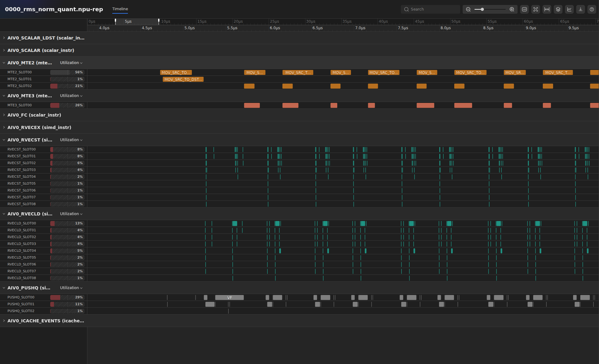
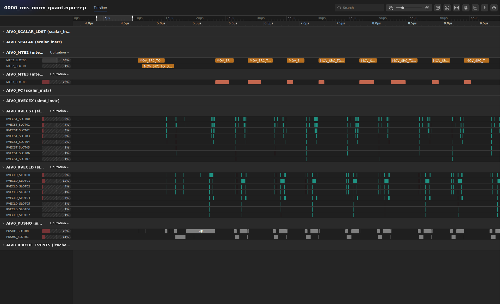
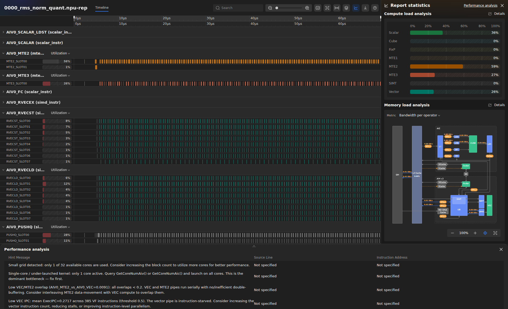
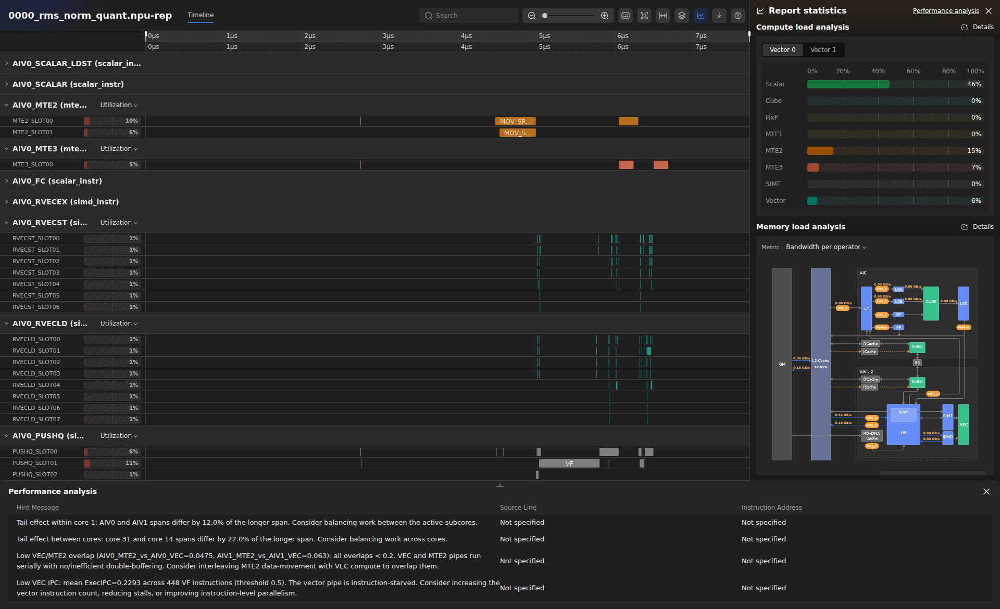
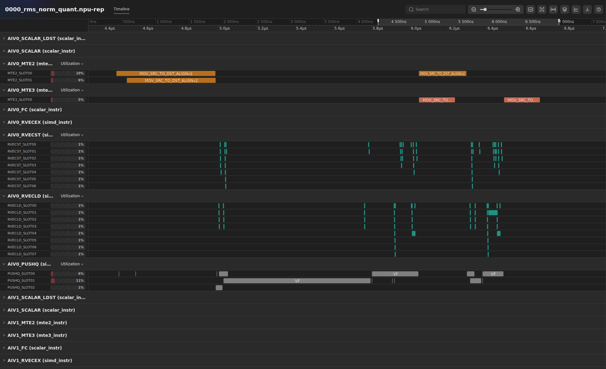
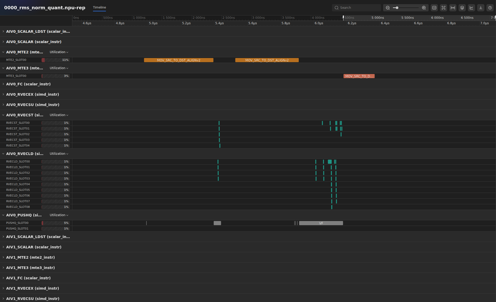
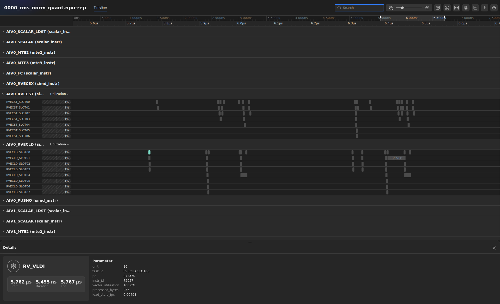
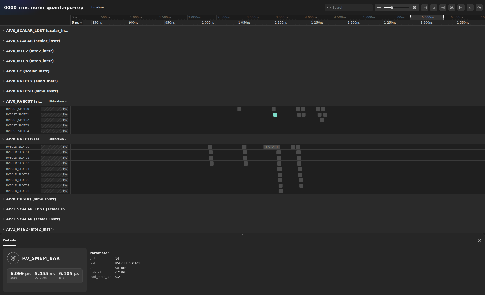
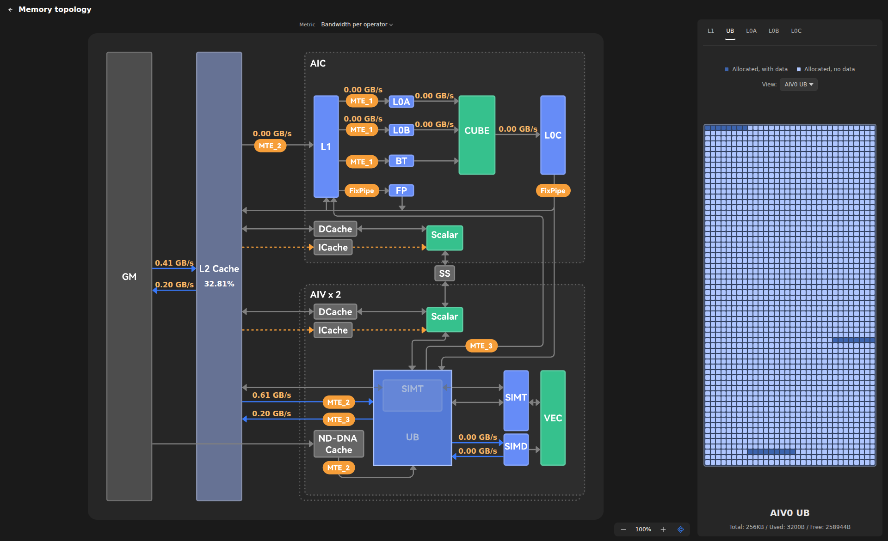
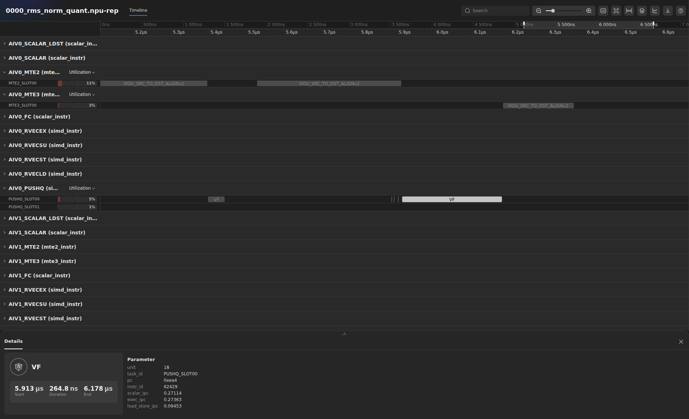

# От видимой проблемы к проверенному улучшению

[English version](DEMO_STORY.md) · [Подготовка и все команды](README.md)

**Четыре отчёта, 7–9 минут: 0 → 1 → 2 → 5.** До выступления откройте сохранённые
`.npu-rep` в [веб-просмотрщике](https://profiling-report.vercel.app/) или в расширении VS Code.
Каждый переход строится одинаково:
находим проблему в отчёте, меняем реализацию и в следующем отчёте проверяем,
что именно изменилось.

Вставлены реальные кадры английского веб-просмотрщика с отчётами из ссылок ниже.
Оригиналы PNG в полном разрешении лежат в `figures/demo/`.

Во всех примерах одна задача: RMSNorm с квантованием, форма **128 × 256**.
Все числа относятся к сохранённым прогонам из ссылок; в новом запуске время может отличаться.
Все четыре проверки результата пройдены с исходным допуском: абсолютная разница
int8 не больше 1. В таблице — такты выполнения ядра в симуляторе, а не время,
которое компьютер потратил на получение профиля.

| Отчёт | Такты ядра | Что показываем |
| --- | ---: | --- |
| 0 — naive | 112,429 | Повторные входные передачи в цикле по строкам |
| 1 — preload gamma | 111,498 | Повторные загрузки gamma убраны; хинт об одном ядре остаётся |
| 2 — multi-core | 8,785 | Работа распределена; Small Grid и Single-core исчезают |
| 5 — batch rows in UB | 7,744 | Меньше запусков VF и передач на каждом subcore |

## Навигация в веб-просмотрщике

Открываем [веб-просмотрщик](https://profiling-report.vercel.app/), в верхней строке
выбираем **en**, чтобы подписи совпадали с этим описанием, и через **Open file…**
загружаем сохранённый `.npu-rep`.

Основную область занимает **Timeline**. Группы дорожек раскрываются и сворачиваются
стрелкой возле названия. Если многочисленные строки SCALAR мешают увидеть MTE2,
MTE3, PUSHQ, RVECLD или RVECST, сворачиваем их. Выбор конкретной инструкции
открывает её детали: там смотрим параметры события.
В многокорных файлах названия групп AIV0/AIV1 повторяются для разных ядер.
На наших кадрах используется **первый блок AIV0 (core 0)**. Считаем события
внутри него, а не по всем одноимённым группам файла.

**Хинты:** справа в панели **Report statistics** нажимаем **Performance analysis**
**сверху справа**. Сообщения появляются в **нижней открывающейся панели**, которая
тоже называется **Performance analysis**. Читаем столбец **Hint Message**; для
хинтов уровня ядра в **Source Line** и **Instruction Address** может быть
**Not specified**. Ссылки **Details** возле Compute/Memory load analysis открывают
списки полей метрик; это не кнопка открытия хинтов.

**Память:** справа в **Memory load analysis** раскрываем схему кнопкой полного
экрана и попадаем в **Memory topology**. Нажимаем блок памяти **UB** на схеме
либо вкладку **UB** справа — появляется сетка использования/покрытия UB.
В просмотрщике также есть вкладки **L1**, **L0A**, **L0B** и **L0C**, но в этих
RMSNorm-записях данные карты есть только для **UB**. В нашем демо выбираем UB
и перед сравнением проверяем владельца карты, например **AIV0 UB**. Выбор другой
вкладки не создаёт отсутствующие данные.

## Первый переход: повторные копирования → загрузить gamma один раз

**До: отчёт 0, Timeline → core 0 → AIV0; раскрываем MTE2 и дорожки векторных инструкций/VF.**
Находим несколько последовательных групп строк после инициализации. Показываем,
как перед вычислением каждой строки повторяется один и тот же рисунок передач.

«Здесь работа идёт строка за строкой. Входная строка меняется, а gamma общая
для всех строк. Но в исходной реализации мы на каждой итерации снова загружаем
и строку, и gamma. На таймлайне видны повторные передачи, а цикл `Process()`
объясняет, какая из них лишняя: `CopyInGamma()` стоит внутри цикла рядом
с `CopyInX(loop)`».

**После: отчёт 1, тот же core, дорожки и число строк.** Сначала захватываем начало
таймлайна с однократной загрузкой gamma, затем сравниваем участок основного цикла.

«Выносим из цикла и загрузку gamma, и её конвертацию в float32.
Повторная загрузка исчезает: теперь на каждой итерации
нужно читать только новую входную строку. Числа в отчёте подтверждают изменение:
входных транзакций стало **129 вместо 256** — 128 строк плюс одна загрузка gamma.
Число выходных передач осталось прежним, 128. Мы убрали повторную работу,
сохранив результат».

Время снизилось на **0.8%**. На этом шаге показываем устранение лишних передач;
основной резерв ускорения станет виден на следующем экране.
Параметры передач в записи пустые: нельзя говорить, что в Details мы видим
одинаковые адреса источника. Назначение gamma определяем по исходному циклу,
а изменение подтверждаем рисунком таймлайна и числом транзакций.

**Рисунок 1. Отчёт 0 — повторные передачи.** На MTE2 повторяются пары входных копирований. Нижние группы RVECLD/RVECST повторяются вместе с вычислением строк.



**Рисунок 2. Отчёт 1 — gamma загружена заранее.** Начальная передача gamma встречается один раз; у последующих строк остаётся одно входное копирование. Сравнить повторяющиеся группы MTE2 и векторных записей с рисунком 1.



Для второй визуальной проверки смотрим **RVECLD → RVECST**: исчезает не только
лишнее копирование в MTE2, но и повторная конвертация gamma с записью в UB.
Событий `RV_VST` на core 0 / AIV0 стало **2,820 вместо 3,328**, а событий подготовки
аргументов `PUSH_PB` — **513 вместо 640**. Повторяющаяся последовательность
теряет работу сразу на нескольких дорожках. Конвертация gamma становится отдельной
начальной VF; общее число VF при этом меняется с 384 на 385. Поэтому здесь
не утверждаем, что стало меньше VF-вызовов.

Исходники для сравнения: [0_naive.asc](NPUSim_Prof_Live_Demo/cann-samples/Samples/2_Performance/rms_norm_quant_story/src/0_naive.asc)
и [1_preload_gamma.asc](NPUSim_Prof_Live_Demo/cann-samples/Samples/2_Performance/rms_norm_quant_story/src/1_preload_gamma.asc), метод `Process()`.

## Второй переход: хинт об одном ядре → распределить независимые строки

**До: отчёт 1, Report statistics → Performance analysis сверху справа; читаем нижнюю панель, затем возвращаемся к общему виду Timeline.**

«Повторные передачи мы убрали, но доступный векторный параллелизм ещё
не используется: все строки выполняются на одном векторном контексте.
Хинт Small Grid сообщает: **используется только 1 из 32 доступных ядер**.
Single-core рекомендует распределить работу. На таймлайне это подтверждается:
всю задачу выполняет один векторный контекст. Строки независимы, поэтому можем
раздать разные строки разным векторным subcore».

**После: отчёт 2, та же нижняя панель Performance analysis и первый блок AIV0 на таймлайне.**

«В записанном выполнении работа уже распределена между ядрами. В первом блоке
AIV0 вместо длинной последовательности остаются две строки. И два сообщения, которые привели нас к этому
изменению, — **Small grid detected…** и **Single-core / under-launched kernel…** — **исчезли** из столбца **Hint Message**.
Сами правила успешно отработали; просто больше нет условия, которое вызывало
эти сообщения. Время сократилось со 111,498 до **8,785 тактов**, то есть примерно
в **12.7 раза**».

В конфигурации 32 физических AI core, у каждого есть AIV0 и AIV1. Значение
`ai_core_active=64` в сводке этого прогона означает 64 активных векторных контекста,
а не 64 физических AI core. Другие сообщения остаются: **Low VEC IPC…**,
**Low VEC/MTE2 overlap…** и **Tail effect…**. Параллелизм запуска исправлен; дальше смотрим внутрь ядра.

**Рисунок 3. Отчёт 1 — хинты об одном ядре.** Кнопка Performance analysis сверху справа открывает нижнюю панель. Первые два сообщения — Small grid detected и Single-core / under-launched kernel.



**Рисунок 4. Отчёт 2 — хинты об однокорном запуске исчезли.** В той же панели теперь Tail effect, Low VEC/MTE2 overlap и Low VEC IPC; двух прежних сообщений нет. На таймлайне показан первый блок AIV0, а не все физические ядра одновременно.



Даже если остаться на core 0, изменение видно: **128 выходных передач превратились
в две**, а **385 запусков VF — в семь**: одна VF для gamma и по три на каждую строку.
Мы убрали длинную последовательную цепочку из одного контекста, распределив её
между 64 векторными контекстами. Сам рисунок вычисления строки остаётся узнаваемым.
Для общего вида используем `.npu-rep`: отдельный JSON `core_0` не покажет остальные
ядра. В локальном сравнении сопоставляем число повторяющихся групп строк
на одном и том же core и компоненте.

## Третий переход: раздробленная работа по строкам → более крупная порция работы

**До: отчёт 2, Timeline → core 0 → AIV0 → события PUSHQ / VF, MTE2 и MTE3.**
Показываем выполнение всего subcore; по возможности не захватываем инициализацию.

«Параллелизм уже есть, но внутри каждого subcore работа всё ещё раздроблена.
На этой маленькой форме каждому subcore достаются две строки. На core 0 / AIV0
можно насчитать **семь VF-вызовов**: один для подготовки gamma, затем по три
на строку. Строки также загружаются и выгружаются отдельными передачами.
Отчёт показывает нам, из каких порций состоит реализация».

**После: отчёт 5, ровно те же core и компонент.**

«В итоговой версии объединяем векторные вычисления и обрабатываем строки пакетом
в UB. Для тех же двух строк на этом subcore теперь нужны только **два VF-вызова**:
подготовка gamma и вычисление пакета. Последовательность VF визуально проще.
По всему ядру число VF сократилось с **448 до 128**, а число самих инструкций
записи `RV_VST` — с **3,072 до 896**».

«Передачи тоже укрупняются. На core 0 / AIV0 вместо трёх входных передач остаются
две: gamma и две отдельные строки превращаются в gamma и один пакет. Выходных
передач вместо двух остаётся одна. В архитектурных метриках, суммарно по 32
физическим ядрам, для каждой стороны AIV это **96 → 64 входных транзакций
и 64 → 32 выходных**. Время сократилось до **7,744 тактов** — ещё на **11.8%**. Те же две строки передаются меньшим числом DMA-команд;
это не означает уменьшения объёма их входных и выходных данных».

Этот переход объединяет MicroAPI, двойную буферизацию и обработку строк пакетом.
Вклад каждого изменения по отдельности он не выделяет. Отчёты 3 и 4 остаются
в пакете для подробного технического разбора, но в основной рассказ не входят.
Весь выигрыш нельзя приписывать только пакетной обработке или утверждать,
что каждое отдельное изменение обязательно ускоряло эту маленькую задачу.

**Рисунок 5. Отчёт 2 — VF и передачи отдельных строк.** В первом блоке AIV0 — семь VF-вызовов на дорожках PUSHQ, три входных копирования и два выходных.



**Рисунок 6. Отчёт 5 — обработка пакета.** В соответствующем блоке AIV0 — два VF-вызова, два входных копирования и одно выходное. Выше PUSHQ видны сократившиеся группы векторных загрузок и записей.



Теперь открываем дорожки **RVECLD / RVECST**. В отчёте 2 группы обработки строк повторно
записывают результаты в UB и читают промежуточные значения обратно. В отчёте 5
больше промежуточных значений остаётся внутри объединённой VF. На этом конкретном
core/subcore событий `RV_VST` стало **14 вместо 48**, `RV_VLD` — **30 вместо 40**,
а все **10 событий `RV_VLDI` исчезли**. Ищем `RV_VLDI` в обоих отчётах и сравниваем
небольшие группы загрузок с заметно поредевшей дорожкой записей. Так виден
механизм изменения, а не только итоговое время.

На той же дорожке RVECST **четыре `RV_SMEM_BAR` превратились в один**, а **семь
маркеров `RV_SEND` — в два**. В новой организации вычислений записано меньше
инструкций барьера памяти и завершения VF. Выбираем эти события и показываем Details. Это не доказывает исчезновение всех задержек синхронизации или зависимостей.

**Рисунок 7. Отчёт 2 — выбрана промежуточная загрузка.** На RVECLD_SLOT00 выбрана RV_VLDI. В нижней панели Details видны точное имя, pc 0x1370, ID инструкции и параметры; выше остаются соседние группы загрузок и записей.



**Рисунок 8. Отчёт 5 — выбран барьер памяти.** На RVECST_SLOT01 выбран оставшийся на core 0 RV_SMEM_BAR. В Details виден pc 0x10cc; окружающая последовательность векторных записей заметно меньше, чем в отчёте 2.



В конце в отчёте 5 открываем **Memory load analysis → кнопка полного экрана → Memory topology**, затем нажимаем блок **UB** или вкладку **UB** справа.
Связываем укрупнённые передачи с путями OUT→UB и UB→OUT и затронутыми адресами UB.
Карта отмечает ячейки, затронутые записанными обращениями. **Used** вычисляется
как число таких ячеек, умноженное на размер ячейки. Это не замер одновременно
живых тензоров или занятости по времени и не доказательство насыщения пропускной способности.
Сообщения **Low VEC IPC…**, **Low VEC/MTE2 overlap…** и часть tail-хинтов сохраняются;
на этом переходе показываем уменьшение дробления работы, а не исчезновение этих хинтов.

**Рисунок 9. Отчёт 5 — покрытие UB.** Memory topology с выбранными вкладкой UB и представлением AIV0 UB. Справа видны сетка покрытия и значения Total / Used / Free.



«Мы прошли три изменения по наблюдаемым признакам: убрали повторные передачи,
задействовали ядра и укрупнили порцию работы на каждом subcore. На этой задаче
итоговая версия примерно в **14.5 раза быстрее исходной**. Для каждого перехода
можно показать конкретный рисунок таймлайна или хинт, который изменился».

## Памятка для подготовки кадров таймлайна

Названия дорожек ниже взяты из сохранённых Chrome Trace для core 0. Просмотрщик
может сокращать подписи: ориентируйтесь на префикс `AIV0_…`. `PUSHQ_DISPATCH` —
отдельная дорожка; считать нужно события с точным именем **`VF` на `AIV0_PUSHQ`**.
Для DMA считаем **`MOV_SRC_TO_DST_ALIGNv2`**, а не начальную настройку `MOV_SPR_XN`.
**`RV_VST`** — одна инструкция, а **RVECST** — вся дорожка: на ней есть также
`RV_SEND`, `RV_SMEM_BAR` и другие инструкции.
Для отчётов 2 → 5 общее число событий RVECST по всем контекстам — 3,904 → 1,088,
а самих `RV_VST` — 3,072 → 896. Эти записи включают подготовку gamma и вывод
результата, а не только промежуточные значения. Числа ниже относятся к core 0 / AIV0.

Все числа здесь относятся к **core 0 / AIV0**, а не ко всему запуску:

| Дорожка / событие | Отчёт 0 | Отчёт 1 | Что видно |
| --- | ---: | ---: | --- |
| MTE2 / `MOV_SRC_TO_DST_ALIGNv2` | 256 | 129 | Вместо повторных пар — однократная загрузка и одиночные загрузки строк |
| PUSHQ / `PUSH_PB` | 640 | 513 | Меньше повторной подготовки аргументов |
| RVECST / `RV_VST` | 3,328 | 2,820 | Меньше повторных векторных записей |
| PUSHQ / `VF` | 384 | 385 | Конвертация gamma стала однократным вызовом; выигрыш не в числе VF |

На скриншоте MTE2 выбираем копирование и проверяем **Details → Parameter → pc**.
В отчёте 0 два повторных места вызова — **`0xd20` и `0xde0`**, по 128 выполнений.
В отчёте 1 **`0xa94` выполняется один раз**, а **`0xe5c` — 128 раз**. Это позволяет
различить места вызова при одинаковых именах копирований и пустом поле `arguments`.
PC относятся к конкретному бинарнику: после пересборки адрес может измениться.

| Дорожка / событие | Отчёт 1 | Отчёт 2 | Что видно |
| --- | ---: | ---: | --- |
| MTE2 / `MOV_SRC_TO_DST_ALIGNv2` | 129 | 3 | На этом контексте остаются две строки и gamma |
| MTE3 / `MOV_SRC_TO_DST_ALIGNv2` | 128 | 2 | От длинной «гребёнки» выходных копирований остаются два зубца |
| PUSHQ / `VF` | 385 | 7 | Тот же рисунок строки, но гораздо меньше последовательных повторений |

| Дорожка / событие | Отчёт 2 | Отчёт 5 | Что видно |
| --- | ---: | ---: | --- |
| PUSHQ / `VF` | 7 | 2 | Несколько коротких групп заменены на gamma и обработку пакета |
| PUSHQ / `PUSH_PB` | 9 | 4 | Меньше подготовки аргументов вокруг VF |
| MTE2 / `MOV_SRC_TO_DST_ALIGNv2` | 3 | 2 | Вместо двух загрузок строк — одна загрузка пакета |
| MTE3 / `MOV_SRC_TO_DST_ALIGNv2` | 2 | 1 | Вместо двух выходных передач — одна |
| RVECLD / `RV_VLD` | 40 | 30 | Меньше векторных загрузок |
| RVECLD / `RV_VLDI` | 10 | 0 | Группы этих промежуточных загрузок исчезают |
| RVECST / `RV_VST` | 48 | 14 | Группы промежуточных записей становятся реже |
| RVECST / `RV_SMEM_BAR` | 4 | 1 | Меньше внутренних маркеров барьера памяти |
| RVECST / `RV_SEND` | 7 | 2 | Меньше маркеров завершения VF |

Чтобы найти изменения, выбираем **core 0 / AIV0**, раскрываем дорожку из таблицы
и ищем точное имя события. Если у копирований одинаковые имена, выбираем одно
и смотрим **Details → Parameter → pc**. Оставляем только нужные для сравнения
дорожки; если мешают scalar slot tracks, сворачиваем их. Указанные выше PC
относятся к сохранённым бинарникам и после пересборки могут измениться.

**Нельзя называть произвольный пустой участок таймлайна stall.** В этих записях
нет отдельных BUBBLE-событий или явных событий `WAIT_FLAG`. Видно уменьшение числа
копирований, загрузок и записей промежуточных данных, барьеров и запусков, но это
не доказывает исчезновение всех ожиданий и не объясняет любой пустой промежуток.
Хинт низкого перекрытия остаётся в отчёте 5: эта пара не демонстрирует идеальное
перекрытие передач с вычислениями.

В README собраны [настройка просмотрщика](README.md#view-the-saved-reports) и
[ссылки на CANN / точные коммиты исходников](README.md#requirements-and-exact-versions).

## Команды: подготовить до выступления

Готовые отчёты можно показывать сразу. Команды ниже выполняем из каталога,
в котором лежит распакованное демо; если уже внутри него, первый `cd` пропускаем:

```bash
cd NPUSim_Prof_Live_Demo

# Собрать и записать четыре примера рассказа. Без меню и вопросов.
# Первые два — медленные однокорные симуляции; подготовить до выступления.
bash start.sh 0 1 2 5

# Либо собрать и выполнить все семь примеров.
bash start.sh

# Повторить одно сравнение либо только собрать примеры.
bash start.sh 2 5
bash start.sh build
bash start.sh --list

# Обновить measurements.json, latest-measurements.json и RESULTS.html.
runtime/python/bin/python3 demo/summarize.py
```

Python и NumPy включены в пакет. На машине нужны CANN 9.3.0 с симулятором
Ascend950/dav-3510, CMake, make и компилятор C/C++; физическая NPU не требуется.
CANN определяется автоматически. Если установок несколько, перед запуском выбираем нужную:

```bash
export CANN_SETENV=/actual/path/to/cann/bin/setenv.bash
```

Скрипты включают все группы сбора, VF-отчёты и все AI core.
Эквивалентная прямая команда для итогового примера:

```bash
source demo/env.sh
export CANNSIM_COLLECT=all
export BIPROF_OPTS='-l debug --save_tmp_files --scalar-ipc --vec-ipc --simd-perf --memory-utilization'
python3 -m npusim.main record \
  "$BUILD_DIR/Samples/2_Performance/rms_norm_quant_story/rms_norm_quant_5_ub_utilization" \
  -s Ascend950 -g vf -n all -o "$RESULTS_DIR/rms_norm_quant_5_ub_utilization"
```

Пересоздать отчёт из сохранённых данных без повторной симуляции:

```bash
source demo/env.sh
RUN="$DEMO_ROOT/results/rms_norm_quant_5_ub_utilization/npusim_20261103215316_rms_norm_quant_5_ub_utilization"
python3 -m npusim.main report -e "$RUN/record" -n all -o "$RUN/report-regenerated"
```

Включённая в пакет отдельная команда `report` по умолчанию экспортирует VF JSON.
Она анализирует сохранённое выполнение и не запускает ядро повторно.
Числа рассказа при этом остаются привязаны к исходным отчётам из ссылок.

## Какие файлы открыть

Открываем эти `.npu-rep` в [веб-просмотрщике](https://profiling-report.vercel.app/) или в расширении VS Code
из [README.md](README.md#view-the-saved-reports). Это ровно те прогоны,
для которых приведены числа и указания к скриншотам. Пути новых прогонов смотрим
в `latest-measurements.json`.

| Шаг | Сохранённый отчёт |
| --- | --- |
| 0 — 0_naive | [Открыть .npu-rep](NPUSim_Prof_Live_Demo/results/rms_norm_quant_0_naive/npusim_20261103211811_rms_norm_quant_0_naive/report/results/0000_rms_norm_quant_reports/0000_rms_norm_quant.npu-rep) |
| 1 — 1_preload_gamma | [Открыть .npu-rep](NPUSim_Prof_Live_Demo/results/rms_norm_quant_1_preload_gamma/npusim_20261103213408_rms_norm_quant_1_preload_gamma/report/results/0000_rms_norm_quant_reports/0000_rms_norm_quant.npu-rep) |
| 2 — 2_multi_core | [Открыть .npu-rep](NPUSim_Prof_Live_Demo/results/rms_norm_quant_2_multi_core/npusim_20261103214712_rms_norm_quant_2_multi_core/report/results/0000_rms_norm_quant_reports/0000_rms_norm_quant.npu-rep) |
| 5 — 5_ub_utilization | [Открыть .npu-rep](NPUSim_Prof_Live_Demo/results/rms_norm_quant_5_ub_utilization/npusim_20261103215316_rms_norm_quant_5_ub_utilization/report/results/0000_rms_norm_quant_reports/0000_rms_norm_quant.npu-rep) |

[RESULTS.html](NPUSim_Prof_Live_Demo/RESULTS.html) — общая офлайн-сводка со ссылками на файлы. Отдельный
`core_0/trace_core0.json` также можно открыть в Chromium через `chrome://tracing`,
но панели Performance analysis в нём нет.

## Примечания докладчику

Используем английские названия элементов viewer из раздела навигации выше.
Для IPC выбираем VF и смотрим
`exec_ipc`, `scalar_ipc`, `load_store_ipc` в **Details → Parameter**, если производитель
их добавил. Отдельного графика VF IPC в этом просмотрщике нет.

**Рисунок 10. Отчёт 5 — VF IPC в Details.** После выбора VF обработки пакета
видны `scalar_ipc`, `exec_ipc` и `load_store_ipc`. Это значения выбранного вызова,
а не среднее по всем вызовам, которое использует хинт Low VEC IPC.



Low VEC/MTE2 overlap остаётся **во всех семи прогонах пакета**. Лучшее перекрытие
среди них — около **0.148** в отчёте 4, что ниже порога правила **0.20**.
Ни один из этих кадров не демонстрирует исчезновение этого хинта.

В манифестах отчётов есть хинты уровня ядра, VF IPC и данные тепловой карты памяти.
Счётчиков VF PMU, строк SIMD stall sampling и bubble-событий в этих записях нет:
не обещаем PMU-хинты или дорожки BUBBLE. `HintPassed=1` означает, что правило
отработало, а не что оно выдало сообщение. Хинты с привязкой к строкам исходника пустые.
[Описание исходного примера](NPUSim_Prof_Live_Demo/cann-samples/Samples/2_Performance/rms_norm_quant_story/README.md)
объясняет реализации; его результаты на большой форме не являются нашими измерениями.
[Проверки и сообщения детекторов](NPUSim_Prof_Live_Demo/RESULTS.html) рассматриваются отдельно от успешной
численной проверки этого демонстрационного набора.
